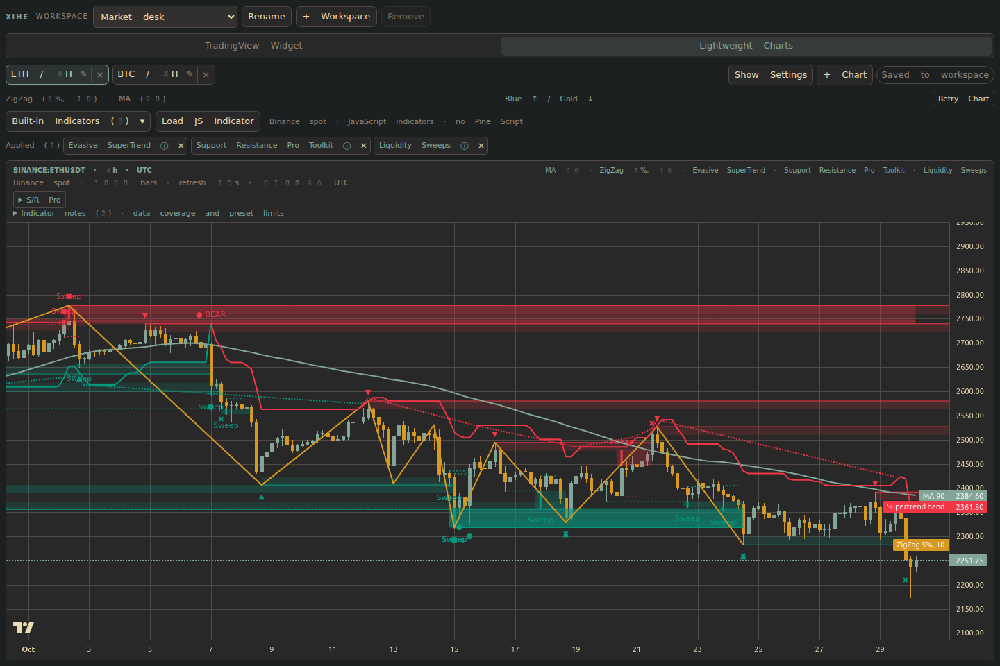
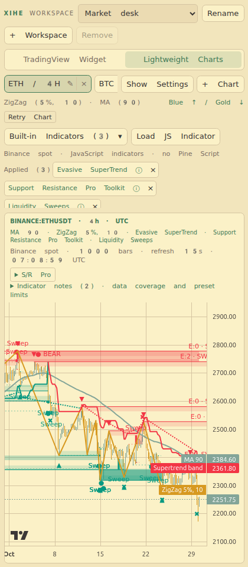
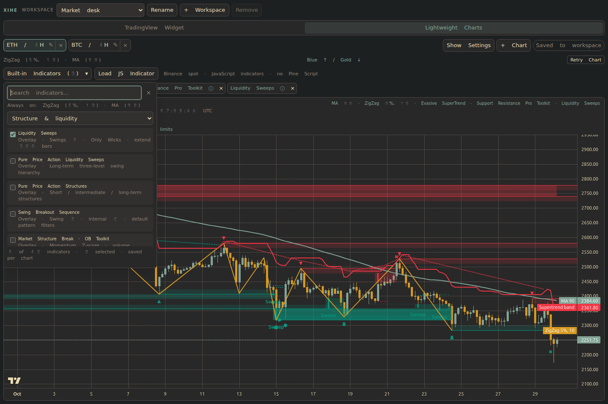
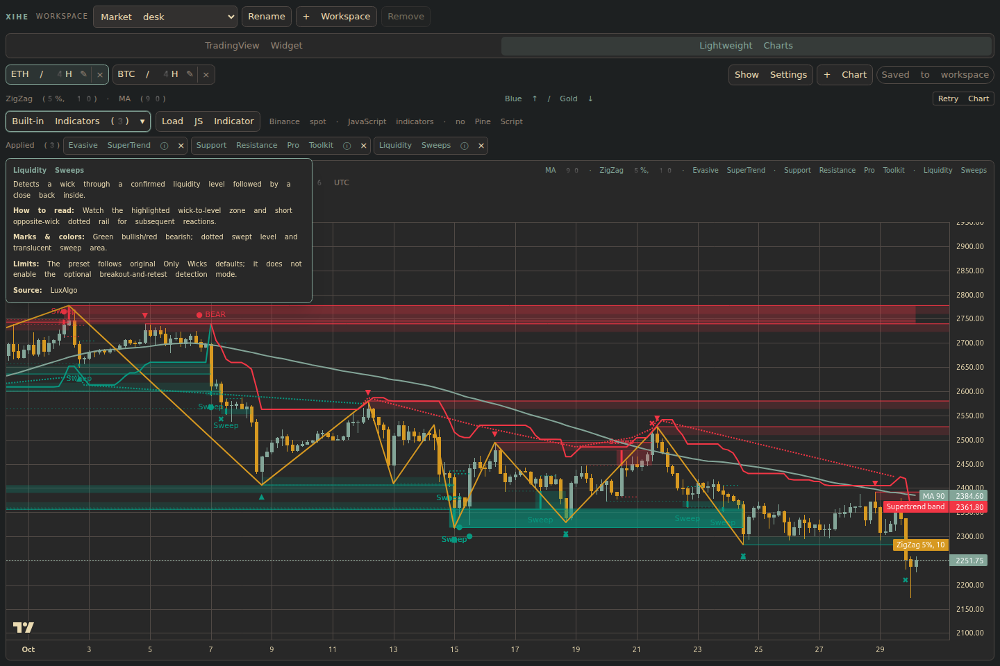

# XiheTradingTerminal


Named after **Xihe (羲和)**, the solar goddess associated with time and celestial cycles. The mark is **Weiji (未济), Hexagram 64**: fire above water. Its forty-nine dots occupy a fifty-position ring, leaving one gap.

A chart workspace for VS Code, with named workspaces, independent chart tabs, and a warm Gruvbox palette. Switch between TradingView's hosted Widget and its official open-source **Lightweight Charts 5.2.1**. Local charts support your own JavaScript indicators.



Overview: named workspaces and chart/engine tabs, with Gruvbox candles and three source-colored indicator layers applied together.


The hosted Widget engine keeps TradingView's chart controls and drawing tools. Both engines share the same workspace shell and candle palette.

## Features

- **Two chart-engine tabs:** choose **TradingView Widget** or **Lightweight Charts** for each chart. Switching engines preserves both instances; chart and workspace tabs remain independent.
- **Local JavaScript indicators:** load a `.js` file into a Lightweight chart. Indicator code and names are saved with that chart. Computation runs in a Worker with a two-second limit.
- **43 optional local presets:** 13 original presets plus 30 source-derived Pine adaptations, organized into eight categories. Search and select several across categories; each chart saves its own overlay stack.
- **Guides and chart annotations:** applied-indicator chips provide hover/focus/click guides based on source calculations and the authors' notes. Source-colored key points, zones, trendlines, profiles and compact statistics appear on the native chart.
- **Native Binance spot intervals:** local charts load public Binance candles, including real **6h / 8h** bars, with MA(90) and ZigZag(5%, 10). The latest 1,000 bars load initially; the visible chart polls every 15 seconds. Hidden charts pause polling and catch up when shown.
- **Named workspaces:** group charts by market, strategy, or trading session. Create, switch, rename, and remove workspaces inside the sidebar.
- **Independent chart tabs:** rename charts with the pencil button or a double-click. Each tab keeps its symbol, interval, theme, and additional indicators.
- **Start with ETH / 4H:** new workspaces open `BINANCE:ETHUSDT` at four-hour resolution, with Settings collapsed by default. Existing saved configurations are retained.
- **Indicators ready on open:** every new chart includes **ZigZag (5% deviation, depth 10)** and **Simple Moving Average (90)**. Existing saved indicators are retained when migrating older settings.
- **Keep charts alive:** switching tabs or workspaces reuses the existing TradingView iframe, preserving indicator adjustments made inside that chart during the session.
- **Gruvbox Dark and Light:** mist-blue up candles (`#83a598`), wheat-gold down candles (`#d79921`), and matching candle borders, wicks, and backgrounds. The palette follows the sibling `kline-trainer` project.
- **Collapsible controls:** hide settings to give the chart more space. Layout and controls use Tailwind CSS 4.
- **Workspace persistence:** chart configuration, names, active selections, and toolbar visibility are saved in the current VS Code project.

<details>
<summary>Lightweight Charts in a narrow Gruvbox Light sidebar</summary>



</details>

Screenshots show the built Webview in a browser with a preview-only VS Code API shim: the real hosted Widget, or Lightweight Charts rendering real Binance spot candles.

## Install locally

Requirements: **VS Code 1.108.1 or newer**, and internet access for TradingView charts.

To build your own installer, use **Node.js 24**:

```bash
npm install
npm run package
```

The packaging tool, `@vscode/vsce`, is installed as a local development dependency. No global installation, Marketplace account, or CI run is needed. Packaging builds the extension and Webview with Vite; **it does not run tests**.

The installer is written to:

```text
dist/xihe-trading-terminal-0.0.4.vsix
```

Extension ID: `AlexiaChen.xihe-trading-terminal`. This renamed extension has a separate identity from the original TradingView Sidebar; its saved settings are not automatically shared with that extension.

In your host machine's VS Code:

1. Open **Extensions**.
2. Select **… → Install from VSIX…**.
3. Select the generated `.vsix` file, install it, and reload VS Code if prompted.
4. Open the **XiheTradingTerminal** icon in the Activity Bar.

If you build in WSL and use VS Code on Windows, select the file from the host VS Code installation dialog and install it in the local extension environment.

## Use the chart workspace

1. Use **+ Workspace** to create a chart workspace, then give it a name. Switch workspaces with the dropdown; use **Rename** to change a name later.
2. Use **+ Chart** to copy the current chart's configuration into a new tab. Rename a tab with its pencil button or by double-clicking its label.
3. Set the symbol with TradingView notation, such as `BINANCE:BTCUSDT` or `NASDAQ:AAPL`.
4. Choose an interval and a Gruvbox theme. ZigZag and MA 90 are included automatically; use **Additional indicators** for supported built-in IDs, such as `RSI@tv-basicstudies`.
5. Use **Hide Settings** to maximize the chart. At least one workspace and one chart are retained.

Use the **TradingView Widget / Lightweight Charts** tabs to switch engines. Both use the same symbol, interval, theme, and mandatory indicator presets. Local charts support `BINANCE:` spot symbols; use the Widget for other exchanges, futures or stocks. Widget study IDs remain saved. Existing local Volume/RSI settings migrate into the local picker; future local changes use the picker, while **Additional indicators** edits the Widget.

## Built-in local indicators

Select **Lightweight Charts → Built-in Indicators**, choose a category, and check several presets. Search names, parameters or Chinese keywords (`MACD`, `斐波那契`, `流动性`, `订单流`). Category filters and searches keep hidden selections intact, so overlays from different categories remain combined. Use arrow keys through results, Enter in search to toggle the first result, and Escape or an outside click to close.

**Applied** chips list your entire selection. Hover, focus, or click a chip for its basic usage, colors, source attribution and limitations; use × to remove just that preset. Expand **Indicator notes** for current coverage and calculation limits, or a compact dashboard for observed statistics.

MA(90) and ZigZag(5%, 10) stay on; optional presets start off in new charts. Each chart saves its own selections, and copying a chart copies those selections independently.

| Overlay presets | Separate-pane presets |
| --- | --- |
| Auto Fib Retracement: latest confirmed ZigZag swing | Volume |
| EMA Ribbon: 20 / 50 / 200 | RSI: Wilder 14 |
| Bollinger Bands: SMA20, 2σ | MACD: 12 / 26 / 9 |
| Donchian Channels: 20 | Stochastic: 14 / 3 / 3 |
| Keltner Channels: EMA20, ATR10 × 2 | ATR: Wilder 14 |
| Supertrend: ATR10 × 3 | Squeeze Momentum: 20, BB2, KC1.5 |
| Session VWAP: HLC3, UTC day | |



Feature view: the Structure & liquidity category, with a selected Liquidity Sweeps overlay alongside Evasive SuperTrend and S/R Pro from other categories. The dropdown overlays the chart without moving it. Checking presets changes only this local chart; its cached Widget and other charts keep their settings.



The applied-chip guide explains how to read the marked sweeps and zones. It is available on hover, keyboard focus and click, while the chart remains visible.

**Auto Fib Retracement measures pullback depth within one ZigZag swing.** The swing's endpoint is 0%, its starting point is 100%. Levels are 0%, 23.6%, 38.2%, 50%, 61.8%, 78.6% and 100%; Indicator notes also reports the current retracement percentage. Negative or above-100% readings mean price is outside that swing. This preset has no extension levels, direction predictions or buy/sell signals. Its latest confirmed anchors may change as new swings develop.

The 13 original presets above use independently implemented formulas; see [their numerical conventions](doc/indicators.md). The additional source-derived presets are grouped as follows:

| Category | Examples |
| --- | --- |
| Trend & channels | Evasive SuperTrend, Trendline Navigator, Trendlines with Hold Rate |
| Momentum & volatility | RSI, MACD, Stochastic, ATR, Squeeze Momentum |
| Support & resistance | S/R Breaks, S/R MTF, S/R Pro, Missed Reversals, NomadaScalper, Tests & Retests |
| Structure & liquidity | Liquidity Sweeps, Pure Price Action Structures, Swing Breakout Sequence, MSB/OB Score |
| FVG & ICT | Instantaneous Mitigation, ICT Unicorn, Pure Price Action ICT, Smart Money Concepts |
| Volume & order flow | Cluster Profiles, Delta Flow, Liquidity Delta/Depth, Volume Delta, Volume Nodes, Volumetric Structure |
| Timeframes & sessions | HTF Reversal/Divergences, HTF PO3, ICT Killzones |
| Signal evaluation | Universal Signal Backtester (default EMA9/21 simulation) |

Each algorithm lives in its own TS file under `src/indicators/builtin/<category>/`; the supplied references use matching [category folders](https://github.com/AlexiaChen/XiheTradingTerminal/blob/main/third-party/tradingview-indicator/README.md). The [30-preset guide](doc/pine-indicators.md) documents usage, source colors, default settings and **implementation differences**. These are fixed adaptations of selected default layers, not full Pine or TradingView parity. Optional original inputs/alerts are not all exposed.

The library remains the pinned npm Lightweight Charts package. Our independent adapter uses its public primitives API; there is no maintained fork or core patch. Base candles retain Gruvbox, while indicator graphics follow the source palette where possible. OHLCV-derived delta and profiles are estimates. Lower-timeframe inputs are fetched separately with bounded coverage; missing data produces a visible explanation. Tick reconstruction and external TradingView signal streams are unavailable.

## Write a local JavaScript indicator

Select **Lightweight Charts → Load JS Indicator** and choose a self-contained `.js` file, such as [examples/indicators/ema-20.js](examples/indicators/ema-20.js). This requires a trusted VS Code workspace. Define a top-level `calculate(bars)` function:

```js
function calculate(bars) {
  let ema;
  const alpha = 2 / 21;
  return [{
    name: "EMA 20",
    color: "#b8bb26",
    data: bars.map(bar => {
      ema = ema === undefined ? bar.close : alpha * bar.close + (1 - alpha) * ema;
      return { time: bar.time, value: ema };
    })
  }];
}
```

Each bar contains `time` (Unix seconds, UTC), `open`, `high`, `low`, `close`, and `volume`. Return an array of plots with a `name`, hex `color`, and ascending `{ time, value }` points using candle timestamps. Optional `type: "histogram"` draws columns; `pane: 1` creates a separate indicator pane. The default is an overlaid line. Files cannot use imports, Node.js APIs, DOM access, or Pine Script.

Up to eight scripts of 64 KiB each can be saved per chart, with at most eight plots per script. Errors, invalid output and two-second timeouts are reported in the local chart. Use the **×** beside a script to remove it. The saved source is a snapshot: edit the file, remove the previous copy, and load it again to apply changes. Required MA and ZigZag presets remain present.

Local ZigZag uses depth-confirmed pivots and a 5% reversal threshold. Pivots are delayed by the confirmation window and the latest extreme may move; it is not a claim of bit-for-bit parity with the hosted TradingView indicator. Local charts use UTC and do not include the Widget's full drawing-tool collection.

## Saved settings and blank charts

Reinstalling the same extension can restore the VS Code project's saved chart configuration, including old SOLUSDT names and symbols. New defaults do not overwrite explicit saved choices. Use **+ Workspace** for a new ETH / 4H workspace, or edit and rename the existing chart.

**Retry Chart** recreates only the selected chart engine. It preserves saved configuration and other chart instances, but discards unsaved edits inside that instance. Hosted-library errors and timeouts are visible even in a narrow sidebar. Check network/proxy access to `s3.tradingview.com` and `www.tradingview.com` for the Widget, or `data-api.binance.vision` for local candles. A frame being created does not prove its remote data loaded.

**XiheTradingTerminal: Reload Sidebar** rebuilds the view from saved configuration. Its command ID is `xihe-trading-terminal.reload`.

## TradingView capabilities and limits

This extension uses TradingView's official hosted widget, loaded from `s3.tradingview.com/tv.js`. Its available features differ from the full TradingView website.

- **Pine scripts:** neither engine executes Pine Script or imports arbitrary community Pine indicators. The local catalog includes 30 explicit TS adaptations of supplied references. The Widget's additional-indicator field accepts supported built-in IDs; user JS files use the contract above. See the [official widget FAQ](https://www.tradingview.com/widget-docs/faq/general/).
- **Widget 6h / 8h:** a real hosted-widget check with `BINANCE:SOLUSDT` on 2026-10-29 fell back to **1D** for both. A warning remains for Widget selections. Lightweight Charts uses Binance's native 6h/8h bars; real ETHUSDT API checks on 2026-10-30 confirmed 21,600 / 28,800 seconds between successive bar opens.
- **Indicator persistence:** chart-internal edits survive tab and workspace switches while the Webview remains alive. A full sidebar reload, VS Code restart, or change to symbol/interval/theme/additional indicators recreates the widget. The hosted API does not expose a full chart-layout export here; internal edits are not restored after recreation. The required defaults and indicators entered in the extension toolbar are restored.
- **Appearance:** TradingView's own menus, toolbars, and individual indicator colors may retain their standard styling. Instrument availability depends on TradingView's feeds and your network.

## Development

The project uses **Vite 8**, **Tailwind CSS 4**, **TypeScript 6**, **Vitest 5**, and **ESLint 10**. Development tooling runs on Node.js 24. The extension targets Node.js 22 and ES2024; the VS Code API typings stay aligned with the minimum supported VS Code version.

```bash
npm ci                   # install the locked toolchain
npm run build            # typecheck and build both Vite bundles
npm run watch            # watch extension and Webview assets
npm test                 # lint, typecheck, build, and offline regression tests
npm run package          # build a VSIX, without running tests
```

Press **F5 → Run Extension** to try the extension in your installed VS Code. Automated checks run offline and do not download or launch a separate VS Code installation.

GitHub Actions runs on pushes, pull requests, and manual dispatch. It installs locked dependencies, runs offline checks and tests, packages the extension, verifies the VSIX contents, and uploads a **xihe-trading-terminal-vsix** artifact. It does not publish to the Marketplace.

The [chart-library comparison and integration notes](doc/context/features/chart-engines.md) record the choice of Lightweight Charts over a general charting toolkit or the separately licensed Advanced Charts product.

`node_modules/`, `out/`, `dist/`, downloaded test installations, and VSIX files are generated locally and excluded from Git. The VSIX includes the compiled extension, Webview JavaScript/CSS, media, README, changelog, license, and screenshots.

Contributor guidance starts at [AGENTS.md](AGENTS.md). Architecture, feature behavior, and validation records are organized in [doc/context](doc/context/README.md).

## Privacy

The extension saves chart configuration and loaded JS source locally in VS Code workspace state and adds no telemetry of its own. Embedded charts connect to TradingView; local charts fetch public Binance spot candles without account credentials. JS calculation runs in Workers, separately from the extension host and Webview DOM.

## License

[MIT for core extension code and independent presets](LICENSE), with source-specific exceptions.

The 28 LuxAlgo-derived presets retain **CC BY-NC-SA 4.0**. The two supplied NomadaScalper/LunqFX references have no local license declaration; no MIT relicensing or upstream permission is asserted. See the bundled [indicator attribution and license notice](third-party/indicator-adaptations-NOTICE.txt) and [per-preset scope](doc/pine-indicators.md).

Bundled [Lightweight Charts](https://github.com/tradingview/lightweight-charts) is licensed under Apache 2.0; its chart attribution remains visible. Third-party licenses and notices are included in [third-party](third-party).
