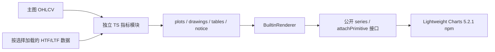

# Pine 参考分类、内建移植和叠加指南

## 用户授权和实现范围

用户先要求调研低侵入扩展，随后授权尽可能移植全部30份参考，按类别整理 Pine 和 TS，增加分类下拉、多选叠加、关键点标记、悬浮指南，完成测试、README/Context/截图和本地 commit。没有推送/发布授权。

目录中主要是指标/可视化工具；Universal Signal Backtester 是 indicator 内的假设模拟，不是可下单策略。30份都有独立的 TS 入口，但这是源算法衍生的**固定预设和选定默认图层**，不是复制所有参数、警报、统计格子或保证 TradingView 逐点一致。英文完整说明及每项差异见 [doc/pine-indicators.md](../../pine-indicators.md)。

## 对齐的分类

| 目录 | Pine 数量 | 内容 |
| --- | ---: | --- |
| trend | 3 | Evasive SuperTrend、Trendline Navigator、LunqFX Hold Rate |
| support-resistance | 6 | S/R Breaks、MTF、Pro、Missed Reversals、NomadaScalper、Tests/Retests |
| market-structure | 5 | Sweeps、PA Sweeps、PA Structures、Swing Sequence、MSB/OB Score |
| fvg-ict | 4 | IMFVG、Unicorn、PA ICT、SMC |
| volume-order-flow | 8 | 聚类/差量分布、机构强度、流动性差量/深度、Delta Candles、Nodes、Volumetric |
| timeframes-sessions | 3 | HTF Reversal、PO3、ICT Killzones |
| signal-evaluation | 1 | EMA9/21 信号假设模拟 |

`third-party/tradingview-indicator/<category>/` 与 `src/indicators/builtin/<category>/` 对齐，原始 Pine 只移动、不改字节。旧13项预设也归类，另有 `momentum` 目录；稳定 ID 不变，保存状态兼容，MA90/ZigZag 不可移除，默认附加项仍为空。

## 计算与渲染分离

- `catalog.ts` 定义八分类与合法 ID；`pineCatalog.ts` 是30项来源、参数和结合作者注释/代码编写的指南元数据；`guides.ts` 合并旧预设指南。
- `types.ts` 定义 line/histogram 和 segment/box/label/path/fill。算法只有 OHLCV、interval 和只读辅助数据，不接触 chart/DOM/Canvas。
- `BuiltinRenderer` 负责各项 series、pane 和 primitive 的生命周期，轮询复用，销毁显式 detach，异常清空该项旧图形；用户 JS 的副图与内建副图独立分配。
- `IndicatorPrimitive` 使用公开 Canvas 渲染目标、价格/逻辑坐标转换，缩放/滚动时重新定位，支持右侧投影而不伪造未来行情。每项最多保留1500个最新绘图对象，达到上限有说明。
- 固定编译的内建公式目前在前端计算，并不继承外部 JS Worker 的2秒超时。用户文件仍走原有可信工程选择、源码快照、Worker和最多8个line/histogram的验证协议；未开放 DOM/图表能力。
- 不 fork/vendor 上游。已核对安装的5.2.1类型中公开 `attachPrimitive`、`detachPrimitive`、`addCustomSeries` 和坐标接口；现有输出协议的不足由本项目适配层解决。只有出现可复现且公开插件 API 无法完成的具体需求，才另评估窄范围上游修改。

官方参考：[Plugin guide](https://tradingview.github.io/lightweight-charts/docs/plugins/intro)、[Series primitives](https://tradingview.github.io/lightweight-charts/docs/plugins/series-primitives)、[示例（含矩形、趋势线、分布）](https://tradingview.github.io/lightweight-charts/plugin-examples/)。

## UI

分类选择与搜索为纯过滤，不改变 `localIndicators`，不重建图表；跨分类勾选持续叠加。已选项统一显示在 Applied 标签区，hover/focus/click 显示用途、图例、局限和作者，Escape/离开/切换范围关闭，× 只移除一项。分类原生 select 的方向键不被结果列表键盘处理拦截。图表顶部提供默认折叠的 Indicator notes 和各指标统计面板，避免长说明挤没 K 线。

## 数据与准确性边界

主图仍为 Binance 现货、UTC、最近1000根、15秒轮询。`IndicatorData` 按选中指标请求4h/1d/1w或1m/5m/15m/1h数据，分页、去重、增量和取消；每流最多12000条，长时间隐藏后从最新预算窗口恢复。连续子周期组不足时不填0、不用主周期代替。

- Volume Delta 只显示有覆盖的父K线，表中报告数量；tick模式不可由15秒快照恢复。
- Volume Nodes 需所选窗口完整覆盖，否则省略并提示，避免使用截断分布冒充完整结果。
- Killzones 原版固定 UTC−5，默认≤15m；不偷偷改成带夏令时的纽约时区。
- HTF PO3 默认1H，要求主周期≤1H且整除；它是当前聚合投影，不是预测。
- HTF Reversal 的15m形态在更大主周期省略，RSI仍可用；按源周期收盘统一发布，明确与原版 lookahead-off/[1] 历史/实时行为的差异。
- S/R MTF 名称不代表独立高周期数据，原版通过比例调整 pivot 长度；本次固定Chart/15。
- Delta/分布/机构强度按各源 OHLCV 估算，不能宣称真实逐笔主买卖、机构成交、盘口深度或预测胜率。
- EMA模拟按闭合bar、SL优先、1/3 TP、默认无费用；收益用每1单位的报价差额，不伪造tickSize或真实成交。未平仓不计入闭合交易统计。
- 多个脚本的枢轴和 ghost/最新窗口图层有回溯或移动属性，指南明确确认时间；没有与 TradingView 全量历史的逐点对拍证据。

## 来源许可和交付

28份声明 ©LuxAlgo / CC BY-NC-SA 4.0；其衍生TS和源指南保留署名、非商业和相同方式共享条件。NomadaScalper、LunqFX两份本地无许可声明，不据此虚构MIT或授权。根LICENSE/README说明适用范围，完整来源清单在 `third-party/indicator-adaptations-NOTICE.txt`。

VSIX额外打包英文指南和该NOTICE，Pine参考源码仍明确排除；`verify_vsix.py`核对实际ZIP白名单和字节。测试和当前构建浏览器截图的结果在 [进度](../project/progress.md) 记录；浏览器使用VS Code API替身，不能冒充真实扩展宿主、用户安装或远程CI结果。
